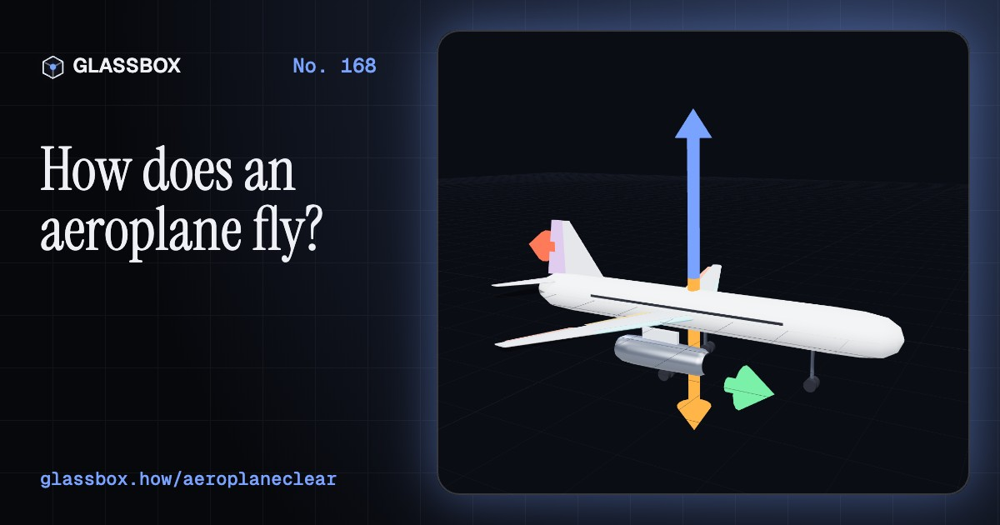
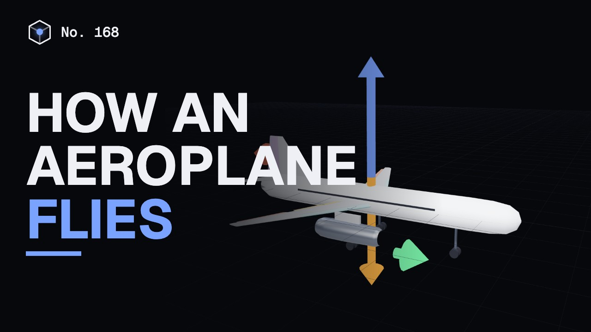
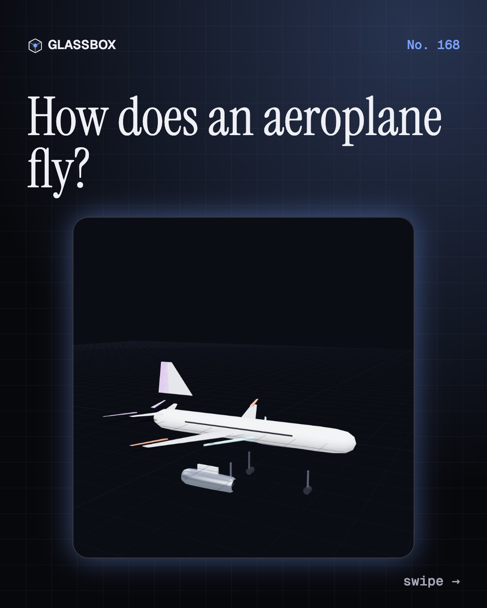
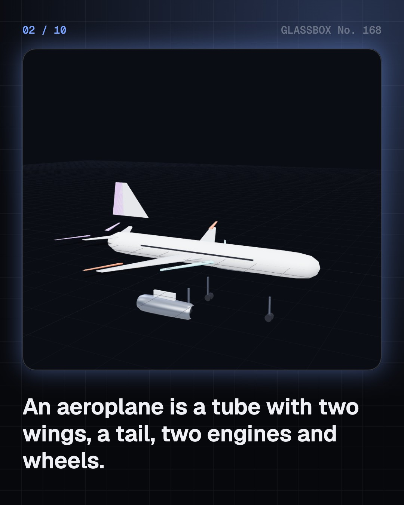
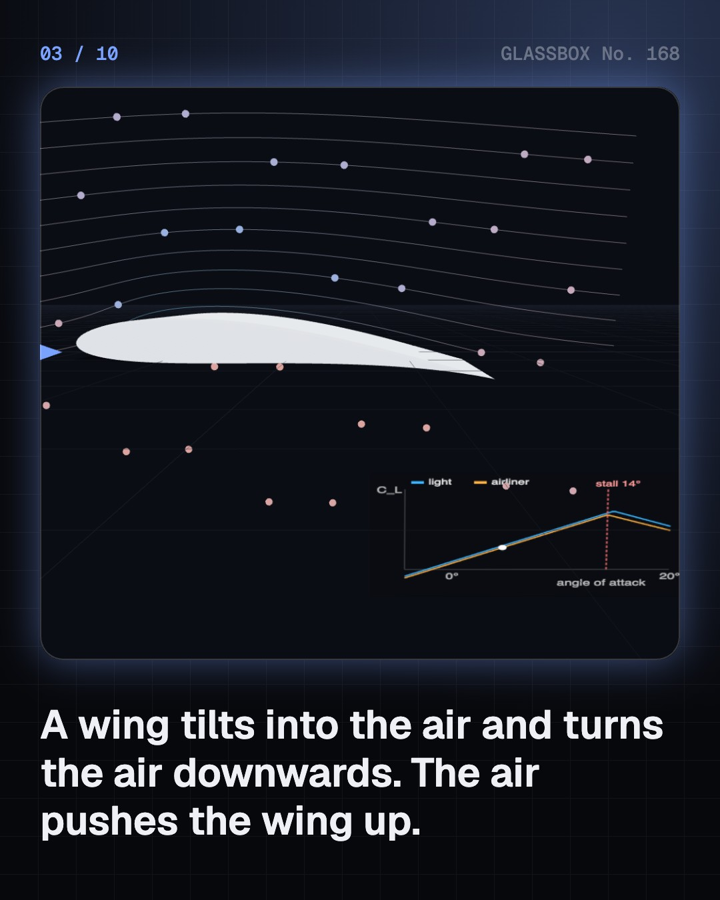
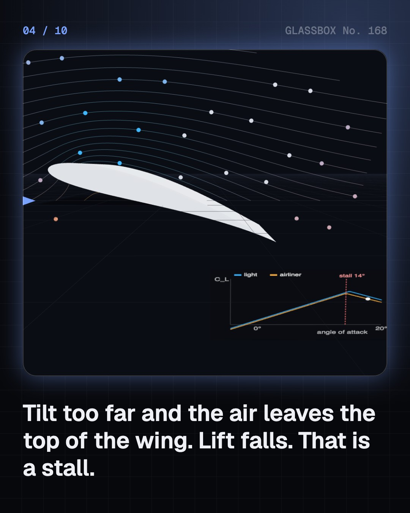

<!-- glassbox:start -->
<!-- Generated from glassbox.json by the Glassbox hub (npm run readme -- aeroplaneclear). Edit glassbox.json, not this block. -->
<p align="center"><a href="https://glassbox.how/e/aeroplaneclear/"></a></p>

<h1 align="center">AeroplaneClear</h1>

<p align="center"><b>How does an aeroplane fly?</b><br>An aeroplane is not sucked up into the sky. Its wings turn the air down, and the air pushes the wing up. Tilt a wing until it stalls, pull an airliner of about 78 tonnes apart, and see why a take-off in Leh needs a longer runway.</p>

<p align="center"><a href="https://glassbox.how/aeroplaneclear/"><b>▶ Play with it</b></a> &nbsp;·&nbsp; <a href="https://glassbox.how/e/aeroplaneclear/">Read the 60-second explainer</a> &nbsp;·&nbsp; <a href="https://glassbox.how/aeroplaneclear/glassbox/reel.mp4">Watch the 40-second video</a></p>

<p align="center">
  <a href="https://glassbox.how/e/aeroplaneclear/"></a>
  <a href="https://glassbox.how/e/aeroplaneclear/"></a>
  <a href="LICENSE"></a>
  <a href="LICENSE-CONTENT.md"></a>
  <a href="#privacy"></a>
</p>

## In 60 seconds

1. **The one-line idea.** A wing makes lift by turning the air down. The air pushes the wing up, and the faster the wing moves through the air, the more it can lift.
2. **The part people get wrong.** The air over the top of a wing does not have to rush to meet the air below. That equal transit time story is wrong, and it explains only a small part of the lift.
3. **Lift against drag.** In level flight the engines push as hard as the drag pushes back. A climb needs extra thrust, and thin air at a high or hot airport means a longer take-off run.
4. **Controls and flaps.** The elevator tilts the nose, the ailerons roll, and the rudder yaws. Flaps lower the stall speed for take-off and landing, and the price is more drag.
5. **The jet and the glide.** A turbofan moves a large mass of air a little, which is efficient. With both engines stopped, the aeroplane still glides, several kilometres for each kilometre it falls.
6. **How we learned.** From Cayley's ideas and Lilienthal's gliders to the Wright brothers in 1903, Tata's first Indian licence in 1929 and the Indian Air Force in 1932.

## Words worth knowing

| Term | Meaning |
|---|---|
| **Lift** | The upward force on a wing, equal to ½ × air density × speed² × wing area × lift coefficient. |
| **Angle of attack** | The angle between the wing's chord line and the air flowing past it. |
| **Stall** | The point where the air separates from the top of the wing at too steep an angle, so lift falls. |
| **Drag** | The force of air resisting the aeroplane's motion, made of parasite drag and the induced drag that comes with lift. |
| **Lift-to-drag ratio** | How much lift a wing makes for each unit of drag. Airliners in cruise reach about 16 to 1. |
| **Density altitude** | The height in standard air that has the same density as the air you are in. |
| **Bypass ratio** | The mass of air a turbofan pushes round its core, divided by the mass that goes through the core. |
| **Glide ratio** | The forward distance an aeroplane covers for each unit of height it loses, in still air. |

## A short history

**From Cayley's sketches and Lilienthal's gliders to the Wright brothers, Indian pilots and the jets of today.**

- **1799** · Cayley sets out the parts of an aeroplane (Sir George Cayley, England)
- **1896** · Lilienthal's gliders (Otto Lilienthal, Berlin and Lichterfelde, Germany)
- **1903** · The Wright brothers fly (Orville and Wilbur Wright, Kill Devil Hills, North Carolina, USA)
- **1909** · Blériot crosses the Channel (Louis Blériot, Calais to Dover, England)
- **1911** · The first airmail flight in India (Henri Pequet, Allahabad, India)
- **1927** · Lindbergh flies New York to Paris alone (Charles Lindbergh, New York to Paris, France)
- **1929** · J.R.D. Tata becomes India's first licensed pilot (J.R.D. Tata, Bombay (Mumbai), India)
- **1932** · The Indian Air Force is set up (British Indian government, British India)

The full story, with 22 moments, charts, people and 25 sources: [glassbox.how/e/aeroplaneclear/history](https://glassbox.how/e/aeroplaneclear/history/). The data lives in [`history.json`](history.json).

## Video and slides

Made with the Glassbox studio from this box's storyboard (`window.glassbox.director`). Free to reuse under CC BY 4.0.

<a href="https://glassbox.how/aeroplaneclear/glassbox/video.mp4"></a>

<p><a href="glassbox/slide-1.jpg"></a> <a href="glassbox/slide-2.jpg"></a> <a href="glassbox/slide-3.jpg"></a> <a href="glassbox/slide-4.jpg"></a></p>

| File | What | Size |
|---|---|---|
| [`glassbox/reel.mp4`](https://glassbox.how/aeroplaneclear/glassbox/reel.mp4) | Reel / Short, with captions and soundtrack | 1080×1920 |
| [`glassbox/video.mp4`](https://glassbox.how/aeroplaneclear/glassbox/video.mp4) | YouTube video, with captions and soundtrack | 1920×1080 |
| `glassbox/slide-1…10.jpg` | Instagram carousel | 1080×1350 |
| `glassbox/thumb.jpg` | YouTube thumbnail | 1280×720 |
| `glassbox/cover.jpg` | Share card and repo social preview | 1200×630 |
| [`glassbox/history-reel.mp4`](https://glassbox.how/aeroplaneclear/glassbox/history-reel.mp4) | “History in 10 moments” Reel / Short | 1080×1920 |
| `glassbox/history-slide-*.jpg` | History carousel | 1080×1350 |
| `glassbox/post.json` | Post copy and schedule used by the publish kit | |

## Privacy

This box has no accounts and no ads, and it ships its own fonts and libraries. When you run it yourself it sends nothing anywhere. On glassbox.how, the site's `/bar.js` also loads Glassbox's analytics: **Google Analytics** to count visits (it asks first in the EU, UK and Switzerland, and stays off when your browser sends Global Privacy Control or Do Not Track) and **ClickTrust** to detect bots.

It remembers a few things **in your own browser only**, and never sends them anywhere:

| Browser storage key | What it holds |
|---|---|
| `aeroplaneclear.v1` | Which chapters you have opened, your best quiz scores, and sound on or off. |

Exactly what each one sees is at [glassbox.how/privacy](https://glassbox.how/privacy/).

## Licences

- **Code:** [MIT](LICENSE). Use it, change it, ship it.
- **Explanations, text, images and videos** (`glassbox.json`, `glassbox/`): [CC BY 4.0](LICENSE-CONTENT.md). Credit “Glassbox, glassbox.how/e/aeroplaneclear”.
- **Third-party parts** keep their own licences: [three.js](https://threejs.org) (MIT), [Geist, Instrument Serif](https://openfontlicense.org) (SIL OFL 1.1).
- The Glassbox name and logo aren't covered by either licence. See the [terms](https://glassbox.how/terms/).

Found a mistake? [Open an issue](https://github.com/bdeeps/aeroplaneclear/issues). Corrections happen in public.
<!-- glassbox:end -->

## Run it

It's plain HTML, CSS and JavaScript. No build step and no dependencies. Run locally, it contacts no other website.

```bash
python3 -m http.server 8000
```

Three.js and the fonts ship in `vendor/` and `fonts/`, so it also works offline.

Then open http://localhost:8000.

## How it's built

| File | What |
|---|---|
| `index.html`, `css/app.css` | The page and its styles |
| `js/app.js`, `js/stage.js`, `js/ui.js`, `js/kit.js` | The shared Glassbox 3D engine: chapters, 3D stage, controls, quiz, video director |
| `js/chapters/*.js` | One file per chapter: the 3D model, controls, text, key terms, quiz and video scenes |
| `js/plane.js`, `js/aero.js` | The aeroplane model (built in metres) and the flight physics: atmosphere, lift, drag, stall, take-off run, glide and the jet sums |
| `glassbox.json` | Title, question, explainer beats, key terms, browser storage and credits shown on glassbox.how |
| `reel` in each chapter | The storyboard the Glassbox studio records into short videos |
| `glassbox/` | The published video, slides, thumbnail and post copy |
| `fonts/`, `vendor/three/` | Self-hosted Geist and Instrument Serif (SIL OFL 1.1) and three.js (MIT) |
